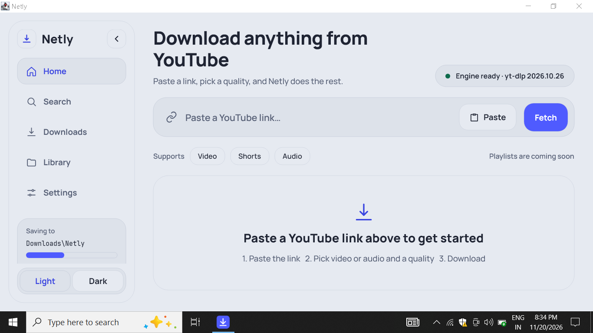
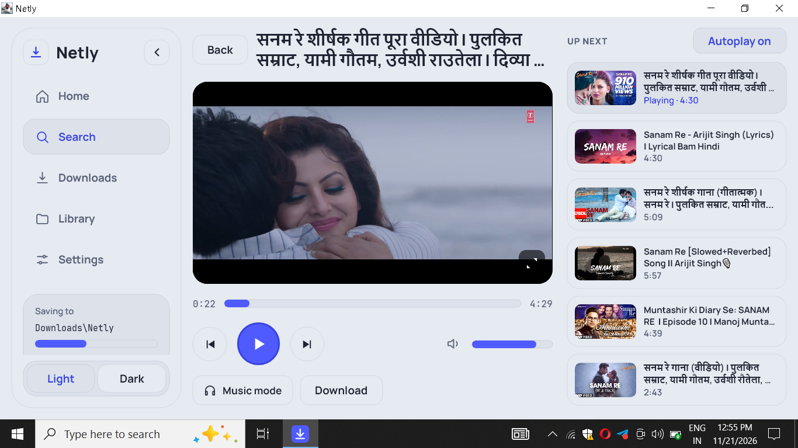
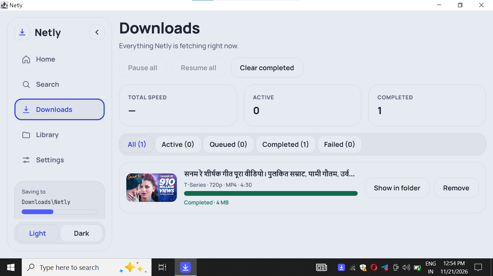
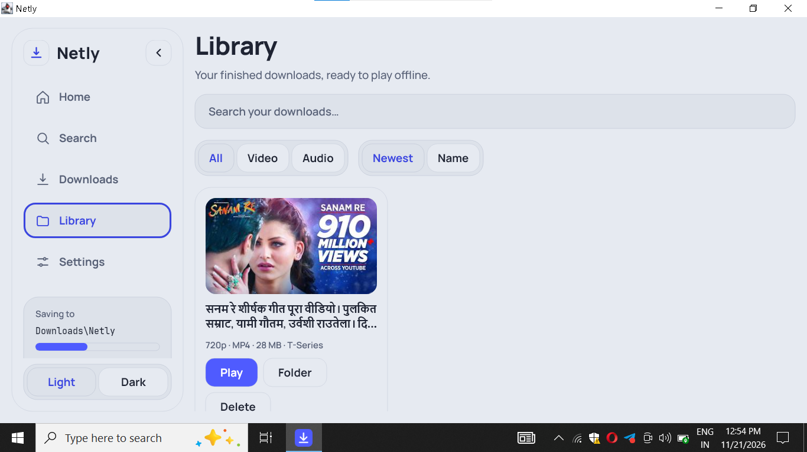
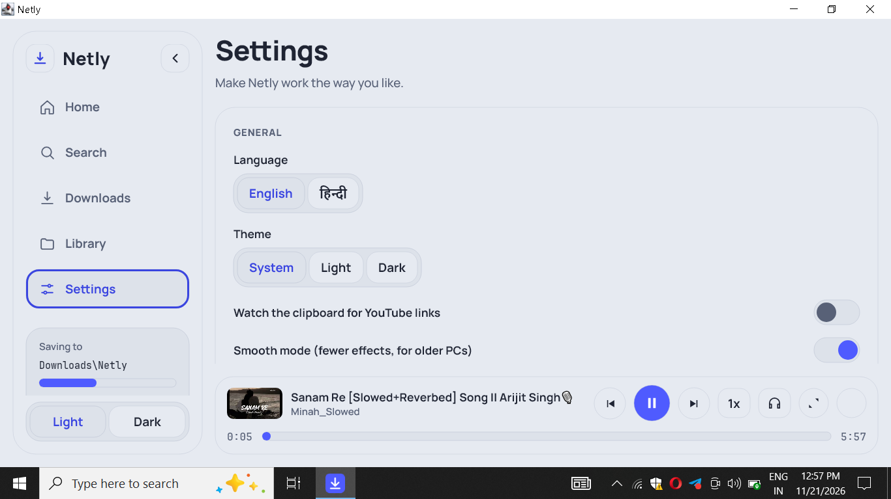
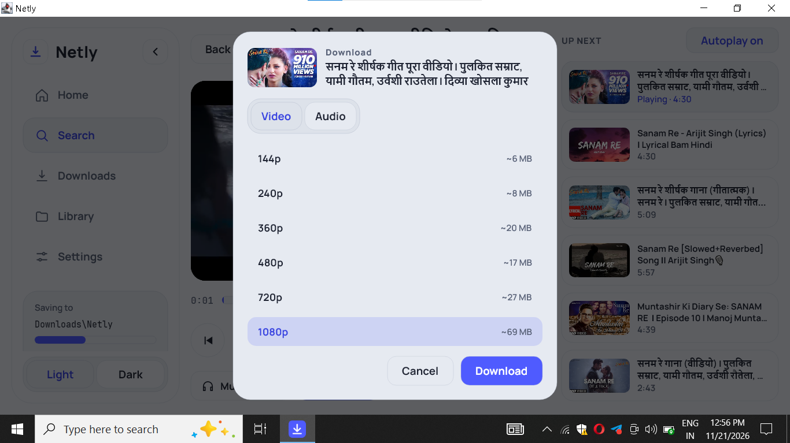

<h1 align="center">Netly for PC</h1>

  <strong>A Modern Video & Music Downloader for Windows</strong>
   
  Download · Stream · Play · Manage
    
  A feature-rich desktop media application with a beautiful soft-neumorphic interface, built for Windows 10 and Windows 11.
    
  
  
  
  
  

---

## 📸 Screenshots

Explore the Netly desktop experience through its interface previews.

<table>
  <tr>
    <td align="center" width="50%">
      <strong>Home</strong>
        
      
       
      Your starting point for discovering and accessing media.
    </td>
    <td align="center" width="50%">
      <strong>Search &amp; Player</strong>
        
      
       
      Search YouTube and play videos or music right inside the application.
    </td>
  </tr>
  <tr>
    <td align="center" width="50%">
      <strong>Download Manager</strong>
        
      
       
      Monitor downloads, progress, speed, and queue status.
    </td>
    <td align="center" width="50%">
      <strong>Library</strong>
        
      
       
      Search, organize, and play your completed downloads.
    </td>
  </tr>
  <tr>
    <td align="center" width="50%">
      <strong>Settings</strong>
        
      
       
      Customize quality, downloads, appearance, and preferences.
    </td>
    <td align="center" width="50%">
      <strong>Choose Your Quality</strong>
        
      
       
      Pick any quality from 144p to 4K, or an audio format, before downloading.
    </td>
  </tr>
</table>

🎬 Video downloads · 🎵 Music streaming · ⚡ Smart download management · 🎨 Light &amp; Dark themes

---

## ✨ About Netly

Netly for PC is a modern Windows desktop application that brings video downloading, audio extraction, online playback, and media library management into one convenient workspace.

Powered by Kotlin, Compose Desktop, yt-dlp, and FFmpeg, Netly combines a clean, soft-neumorphic design with practical features for everyday media use.

Search for YouTube videos and playlists, stream supported content without downloading, save media in your preferred format, and manage completed files from a single application.

**One app. Your media. Your way.**

## 🚀 Key Features

### 🎬 Video & Audio Downloads

- Choose the quality yourself: a dialog lists every available size from 144p up to 4K (2160p), with estimated file sizes.
- Videos are saved as MP4 up to 1080p; 1440p and 4K are saved as MKV.
- Extract audio in MP3 (320 kbps / 192 kbps), M4A, and Opus formats, where supported.
- Download entire playlists or select individual videos.
- Configure the download folder, file naming, and speed limits.
- Pause and resume downloads.
- Automatically retry recoverable network failures.
- Backup download route if YouTube blocks a request.

### 🔎 Built-in YouTube Search

- Search for videos and playlists inside Netly.
- Display results in the order returned by YouTube.
- Start online playback directly from search results.
- Add individual videos or playlists to your download workflow.

### ▶️ Integrated Media Player

- Stream supported videos without downloading them first.
- Full-screen video (button, double-click, or F11; Esc to leave).
- Switch to Music Mode for audio-only streaming.
- Use a compact mini player or the full player.
- Control playback with previous, next, and autoplay.
- Manage upcoming tracks and videos through the Up Next list.
- Adjust playback speed from 0.5× to 4×.
- Select streaming quality from 144p to 720p.
- Control playback volume.

### 📚 Download Library

- Browse completed downloads in one organized list, with preview pictures.
- Search and filter your saved media.
- Play downloaded video and audio files directly, even offline.
- Access saved media without manually searching through folders.

### ⚡ Download Manager

- Real-time download progress, speed, and estimated time remaining.
- Individual pause and resume controls.
- Queue management for multiple downloads.
- Automatic retry for recoverable network errors.
- Configurable speed limits for bandwidth management.

### 🎨 Modern Desktop UI

- Soft-neumorphic design with light and dark themes.
- English and Hindi language support.
- Collapsible sidebar and light, smooth animations.
- Smooth Mode with fewer visual effects for low-end PCs.

### ⚙️ Smart Settings

- Default video and audio quality.
- Custom download directory.
- File naming preferences.
- Browser cookie configuration for supported workflows.
- Optional proxy configuration.
- Clipboard link watcher.
- System tray integration.
- Optional launch on Windows startup.
- Automatic yt-dlp engine updates and an in-app Netly update check.

## 🛠️ Built With

| Technology | Purpose |
|---|---|
| Kotlin | Application programming language |
| Compose Desktop | Desktop UI framework |
| yt-dlp | Media extraction and download engine |
| FFmpeg | Media processing, conversion and playback |
| Windows Installer | Application installation |

## 💻 System Requirements

- Operating System: Windows 10 (1809+) or Windows 11
- Architecture: 64-bit (x64)
- Dependencies: yt-dlp and FFmpeg are bundled with the application
- Internet: Required for online search, streaming, downloads, and engine updates

## 📦 Installation

1. Open the [Releases page](https://github.com/sumitkumartiwari19-sudo/Netly-pc/releases/latest).
2. Download the Windows installer (`.exe`), or the portable `.zip`.
3. Run the installer and follow the on-screen instructions.
4. If Windows shows **"Windows protected your PC"**, click **More info → Run anyway**. Netly is not code-signed yet.
5. Launch Netly and start exploring.

The installer includes the required media tools, so separate yt-dlp and FFmpeg installations are not necessary.

**Verify your download (optional):** compare `Get-FileHash .\Netly-<version>.exe -Algorithm SHA256` with the value in `SHA256SUMS.txt` on the release page.

## 🗺️ Roadmap

- Further UI polish and desktop usability improvements.
- Additional performance optimizations for low-end PCs.
- Enhanced download queue and error-handling workflows.
- Continued improvements to playback and library management.
- Additional customization options.

## 🔒 Privacy & Security

- No account, no ads, no tracking. Your settings and library stay on your PC. See [PRIVACY.md](PRIVACY.md).
- Found a vulnerability? Please read [SECURITY.md](SECURITY.md) and report it by email instead of a public issue.
- Third-party software and licenses: [THIRD_PARTY_NOTICES.md](THIRD_PARTY_NOTICES.md).

## ⚖️ Responsible Use

Netly processes media requests initiated by its users. Users are responsible for ensuring that they have the necessary rights and permissions to download, store, or use the content they access.

Only download or save content when you have the right to do so. Respect copyright laws, content creators, and the terms of service of the platforms you use. Netly is an independent project and is not affiliated with YouTube or Google.

## 🐞 Feedback & Support

Found a bug or have an idea? [Open an issue](https://github.com/sumitkumartiwari19-sudo/Netly-pc/issues/new) or email **mr.sumitkumartiwari19@gmail.com**. You can also use *Settings → Help and feedback* inside the app.

## 👨‍💻 Developer

Developed by **Sumit Kumar Tiwari**.

[Portfolio](https://developer-sumit.netlify.app) · [GitHub](https://github.com/sumitkumartiwari19-sudo) · [Instagram](https://www.instagram.com/sumitkumartiwari19) · [Email](mailto:mr.sumitkumartiwari19@gmail.com)

Netly for PC is released under the [MIT License](LICENSE).

---

  <strong>Netly for PC</strong>
   
  A smarter way to download, stream, and manage your media.
    
  Made with Kotlin ❤️

